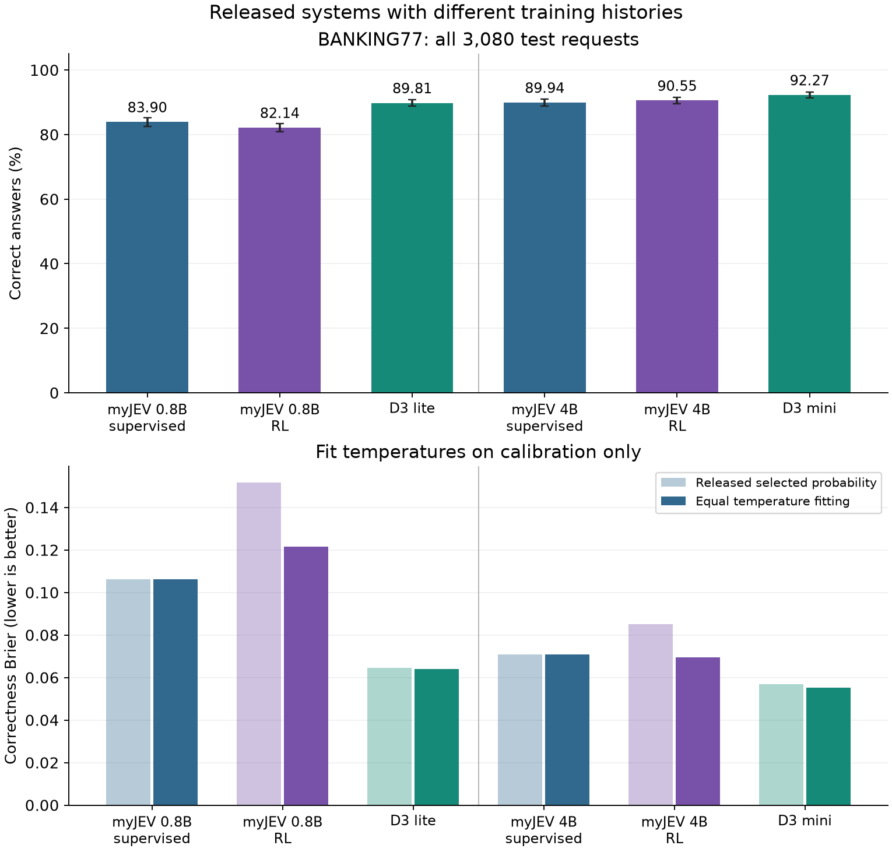
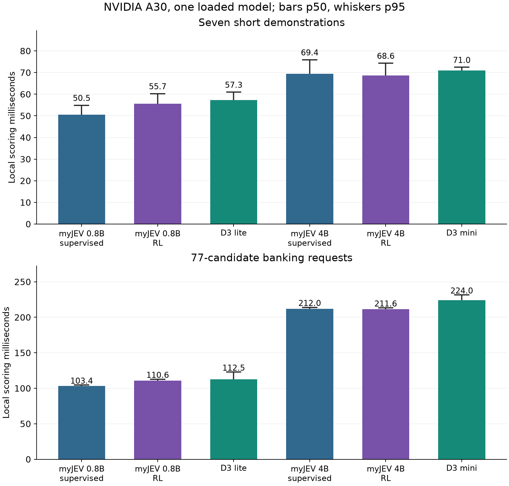

# Compare Decision 3.0 with myJEV

Decision 3.0 supplies another way to turn Qwen representations into choices. The vLLM Semantic Router team publishes its weights and inference code on [Hugging Face](https://huggingface.co/collections/vllm-sr/decision-30). I selected `d3-lite` and `d3-mini` because they start from the Qwen3.5-0.8B and 4B families used in our study. We compare each with the supervised and RL myJEV releases at the corresponding size.

The [frozen protocol](../configs/decision3-v1.json) identifies every checkpoint and input file. These models have different training histories, prompts and output layers. The results compare the released systems and cannot identify which individual design choice caused a difference. Decision 3.0's exposure to these public benchmarks during training is unknown.

## What the local comparison measured

Each release completed 5,731 quality requests, including all 3,080 official BANKING77 test examples and 1,000 reserved calibration examples. The confidence columns below use the selected option's probability. Correctness Brier compares that number with whether the answer was right; lower is better. D3's entropy-based API confidence and myJEV's learned RL confidence remain separate in the [full report](../results/decision3-v1/report.md). The supervised myJEV releases already apply a temperature fitted on these calibration rows; their returned selection scores are calibrated, while D3 and myJEV RL return an uncalibrated selection softmax. The common refit therefore chooses temperature 1.0000 for the supervised releases.

| Model | BANKING77 accuracy | Returned selection Brier | Brier after the same temperature fit |
|---|---:|---:|---:|
| myJEV 0.8B supervised | 83.90% | 0.1062 | 0.1062 |
| myJEV 0.8B RL | 82.14% | 0.1518 | 0.1216 |
| d3-lite, 0.8B | 89.81% | 0.0645 | 0.0640 |
| myJEV 4B supervised | 89.94% | 0.0709 | 0.0709 |
| myJEV 4B RL | 90.55% | 0.0850 | 0.0695 |
| d3-mini, 4B | 92.27% | 0.0569 | 0.0553 |



D3 lite's accuracy advantage over supervised myJEV was 5.91 percentage points, with a paired 95% group-bootstrap interval of +4.80 to +7.08. D3 mini gained 2.34 points over supervised 4B, with an interval of +1.46 to +3.28. The intervals condition on these checkpoints and omit variation from retraining. They do not isolate a head-architecture effect.

The same BANKING calibration rule transferred poorly to some unsupported requests. With thresholds selected for 80% calibration coverage, and equal selection-temperature fitting, d3-mini accepted 54 of 256 out-of-scope CLINC requests when no correct option was present. Supervised myJEV 4B accepted 10. Every accepted answer in that cohort is wrong by construction. On 150 nearby unsupported requests, the counts were 55 and nine. When an explicit `none` option was supplied for out-of-scope requests, accuracy was 82.03% for d3-mini and 82.42% for supervised 4B. These are different decisions: selecting an available rejection option and deferring based on confidence.

The supported distant-domain CLINC subset went the other way: d3-mini reached 97.66%, compared with supervised 4B's 81.25%. The report retains all six cohorts, each model's achieved coverage and accepted errors, and the unmodified banking thresholds. No CLINC labels entered fitting.

On the five perturbations of the same 64 banking cases, d3-mini changed no answers. D3 lite changed five under reversed order, three under the recorded shuffles and one under renamed IDs. Both D3 models answered all seven authored demos correctly. Those small diagnostics do not establish invariance to arbitrary request changes or general task accuracy.

### Reuse the recorded predictions

The [optional evidence bundle](../results/README.md#restore-inputs-for-a-cpu-replay) contains the text-free probabilities and timings. These commands use the installed project environment and require no model download, API key or GPU:

```bash
python scripts/fetch_evidence.py --bundle decision3
python scripts/summarize_decision3.py --require-benchmark
python scripts/plot_decision3.py
```

[Public source mapping](../results/decision3-v1/public-source.json) identifies an accessible commit matching the frozen evaluation code. [Verification](../results/decision3-v1/verification.json) checks every request hash and score, recomputes test metrics, and confirms that isolated benchmark responses equal the quality-run responses. Its `native_confidence_definition_checked` field tests D3's entropy formula only. A false value for a myJEV row means that formula does not apply to that model.

## Follow a request through both models

For “I was charged twice,” the application supplies `billing`, `technical` and `other`. Both implementations attach short, single-token codes to the choices inside the prompt. Those codes let a final input representation produce one score per allowed answer, without generating answer text.

Our released myJEV model selects rows from Qwen's existing vocabulary projection. The added heads estimate candidate correctness. The separate [candidate-attention experiment](candidate-head.md) replaces answer selection with a trainable attention layer over frozen Qwen features.

Decision 3.0 instead loads a separate matrix with 255 output rows from `readout.safetensors`. Multiplying the final token's feature vector by that matrix gives answer-code scores. It masks out codes beyond the current candidate count and normalizes the remaining scores. A 255-row output layer allows a request to supply different choices; those rows do not name 255 permanent business categories. Our implementation already projects only the supplied aliases, so a narrower stored output matrix alone does not establish a speed advantage over myJEV.

| Choice | Released myJEV | Candidate-attention experiment | Decision 3.0 |
|---|---|---|---|
| Answer scores | Qwen vocabulary rows for supplied aliases | Shared scorer after candidate-to-context attention | Separate 255-row answer-code projection |
| Backbone | Qwen with LoRA adapters | Frozen Qwen | Released Qwen-derived weights |
| Confidence | Calibrated selected probability or learned RL policy expectation | Temperature-scaled selected probability | API field measures one minus normalized entropy |
| Questions per model input | One | One | One; several questions can be batched |

The reviewed D3 runtime also changes attention. Its full-attention layers can read both earlier and later prompt tokens. The Gated DeltaNet layers retain their causal recurrence, so it would be inaccurate to describe the whole network as a bidirectional encoder. Our released Qwen path retains the backbone's causal behavior. The D3 code does not establish whether its training used LoRA or full weight updates; the published package contains inference weights and a readout.

## Read confidence according to its definition

Suppose a two-option request returns probabilities 0.9 and 0.1. The first answer has selected probability 0.9. D3's `confidence` is about 0.531 because it measures how concentrated the distribution is:

$$c_{\text{entropy}} = 1 - \frac{H(p)}{\ln K},\qquad H(p)=-\sum_{k=1}^{K}p_k\ln p_k.$$

Here $K$ counts options. A uniform distribution gives zero; all probability on one option gives one. For our example, $H(p)\approx0.3251$ and $\ln 2\approx0.6931$, giving $1-0.3251/0.6931\approx0.5310$. The calculation uses only the distribution and never observes whether the answer was correct.

The comparison retains that field as `native_confidence` and reports its ability to rank correct answers above errors. It uses selected-option probability for common Brier and calibration comparisons. A second view fits the same positive temperature procedure to each model's calibration probabilities. Our RL policy confidence is reported separately. Carrying an application threshold from one of these fields to another would change its meaning.

Fitting uses log probabilities with a predeclared floor of 1e-12. Of 77,000 calibration option probabilities per model, 9,564 values in the 0.8B RL release and 17,516 in 4B RL needed that floor; the other four releases needed none. The analysis operates on the API's returned probabilities. It cannot recover distinctions between raw logits after those probabilities have rounded to zero.

## What runs on an NVIDIA A30

The team name refers to vLLM Semantic Router. The reviewed release runs through Transformers and custom PyTorch code; it does not provide an automatic conversion of our models into the vLLM serving engine. Its AMD fast path checks for ROCm. On the A30, D3 uses its standard CUDA path. Our comparison verifies one backbone invocation per request and zero generated output tokens for D3.

Both backbones use BF16 and the PyTorch reference implementations for causal convolution and the gated delta rule. D3 requires Transformers 5.17.0 for this comparison; myJEV retains the release's 5.18.0 environment. PyTorch is 2.14.1 on both paths. The D3 vision tower remains loaded, although the study sends only text. No image or video accuracy is measured.

Publisher latency numbers use AMD MI325X hardware. The local benchmark measures one model at a time on A30 GPU 0 after the concurrent quality jobs finish. It records synchronized scoring time, backbone GPU time and peak memory for short demonstrations and 77-candidate banking requests. Loading time includes D3's full package hash verification. The measurements exclude HTTP and downloading.

The native prompts also differ in length. Across the 64 distinct banking benchmark requests, D3's median input is 950.5 tokens and myJEV's is 872. Across the seven short demos, those medians are 145 and 123. D3 includes application IDs alongside descriptions; myJEV maps those IDs outside the prompt. The [token accounting](../results/decision3-v1/prompt-tokens.json) retains each count. A latency difference includes this rendering choice as well as model computation.

| Model | Short-demo p50 / p95, ms | BANKING p50 / p95, ms | Peak allocated GiB | Cached load, s |
|---|---:|---:|---:|---:|
| myJEV 0.8B supervised | 50.46 / 54.91 | 103.37 / 104.60 | 1.535 | 1.00 |
| myJEV 0.8B RL | 55.66 / 60.28 | 110.56 / 112.75 | 1.535 | 1.39 |
| d3-lite | 57.29 / 61.00 | 112.47 / 122.87 | 1.710 | 3.52 |
| myJEV 4B supervised | 69.40 / 75.95 | 211.98 / 214.01 | 8.153 | 2.12 |
| myJEV 4B RL | 68.60 / 74.37 | 211.55 / 213.25 | 8.153 | 2.14 |
| d3-mini | 71.01 / 72.46 | 223.99 / 231.55 | 8.701 | 9.27 |



Each model has 192 measured banking calls and 35 short-demo calls, with five initial warmups and five more at each workload boundary. Numeric labels and bars show p50; whiskers show p95. These are local scoring measurements with CUDA synchronization, including tokenization and response conversion. The saved records also contain backbone GPU-event timings and peak reserved memory. Quality-run timings overlapped other GPUs and are excluded from this table. The reference kernels can make these D3 timings pessimistic relative to an optimized D3 deployment. The table does not establish that myJEV would be faster under matched optimized backends.

## Run the comparison

Use the [reference environment](quickstart.md#install-and-test) for myJEV. Create a separate Linux environment for D3 with the same requirements except `transformers==5.17.0`:

```bash
python3.12 -m venv .venv-decision3
.venv-decision3/bin/python -m pip install -r requirements.decision3.lock
.venv-decision3/bin/python -m pip install --no-deps .
```

The recorded host reused the reference environment's packages through a `.pth` file and installed that Transformers version locally; it did not change the released runtime. The commands above give a self-contained installation instead. The run receipts list the imported versions. Neither optimized FLA nor `causal-conv1d` was installed.

Prepare the same BANKING77 and CLINC150 partitions from their pinned source revisions. Their [dataset cards](README.md#data-and-provenance) explain the labels and exclusions. Use a separate output for new model evaluations so the recorded study files remain available:

```bash
python scripts/prepare_banking.py --revision 57ec275d8078af65b7731c2a98be812d844a6d6b
python scripts/prepare_clinc.py --revision 828f8093932c8fe6ca7936c3d2e52903b1c523de
```

Download the two complete D3 snapshots, including their example assets: upstream integrity verification checks those files too. Model weights and cards remain under their upstream Apache 2.0 license.

```bash
export HF_HOME="$PWD/.cache/huggingface"
hf download vllm-sr/d3-lite --revision a8d25a91ef75552803f7009d25b7bd435991abd9
hf download vllm-sr/d3-mini --revision a475367de0d8133a3c1a2a0dc12303d89cfa2ab4

# Activate the D3 environment:
source .venv-decision3/bin/activate
OMP_NUM_THREADS=1 MKL_NUM_THREADS=1 python scripts/run_decision3.py \
  --model d3-lite --phase quality --device cuda:0 --output results/decision3-replay
OMP_NUM_THREADS=1 MKL_NUM_THREADS=1 python scripts/run_decision3.py \
  --model d3-mini --phase quality --device cuda:0 --output results/decision3-replay

# Switch back to the installed reference environment:
source .venv/bin/activate
python scripts/run_decision3.py --model myjev-0.8b --phase quality --device cuda:0 --output results/decision3-replay
python scripts/run_decision3.py --model myjev-0.8b-rl --phase quality --device cuda:0 --output results/decision3-replay
python scripts/run_decision3.py --model myjev-4b --phase quality --device cuda:0 --output results/decision3-replay
python scripts/run_decision3.py --model myjev-4b-rl --phase quality --device cuda:0 --output results/decision3-replay
```

Each run validates the frozen data hashes and saves predictions as it goes. `--resume` requires matching protocol and runner hashes. Run each model again with `--phase benchmark --output results/decision3-replay` in its corresponding environment while the GPU is otherwise idle, then regenerate the report and figures:

```bash
python scripts/summarize_decision3.py --root results/decision3-replay --require-benchmark
python scripts/plot_decision3.py --root results/decision3-replay
python scripts/decision3_token_counts.py --root results/decision3-replay
```

`scripts/run_decision3_study.py --output results/decision3-replay` automates the three-GPU schedule and subsequent isolated benchmarks when the reference environment and `.venv-decision3` are both available. It runs with Hugging Face downloads disabled, so populate the cache first. The two `hf download` commands above cache D3. For myJEV, run `scripts/run_decision3.py --model NAME --phase smoke --output results/decision3-replay` for each of the four release names in the reference environment; its loader downloads the required adapters, heads and pinned backbones. Add `--resume` to continue an identical evaluation.

The driver's optional `--wandb` flag uses the existing [tracking configuration](tracking.md). It uploads request progress and system telemetry; predictions are also flushed to local files after every request. After completing the quality and benchmark phases and drawing the figures, `python scripts/sync_decision3.py --upload` adds the recorded study's summary tables, figures and text-free predictions to W&B. Use `--root results/decision3-replay` for your new run. The analysis and figures can be regenerated from local evidence without W&B access.

## Sources

- [d3-lite card and pinned files](https://huggingface.co/vllm-sr/d3-lite/tree/a8d25a91ef75552803f7009d25b7bd435991abd9).
- [d3-mini card and pinned files](https://huggingface.co/vllm-sr/d3-mini/tree/a475367de0d8133a3c1a2a0dc12303d89cfa2ab4).
- [Runtime, including entropy confidence and attention masks](https://huggingface.co/vllm-sr/d3-mini/blob/a475367de0d8133a3c1a2a0dc12303d89cfa2ab4/d3_runtime.py).
- [AMD fast-path device checks](https://huggingface.co/vllm-sr/d3-mini/blob/a475367de0d8133a3c1a2a0dc12303d89cfa2ab4/d3_fast.py).
