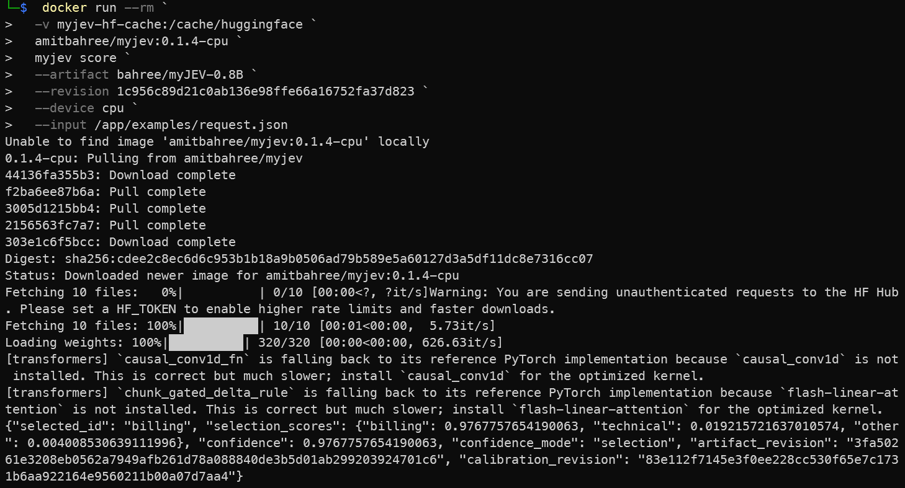

# Run myJEV with Docker

The container supplies Python, the myJEV loader and its dependencies. On first startup it downloads the selected release from Hugging Face, including its adapters, confidence heads and calibration settings, then downloads the pinned Qwen backbone. A named Docker volume keeps those files for later runs. You do not need to train anything, clone the repository or deploy a Hugging Face endpoint.

Use the supervised 4B model for the NVIDIA example, or the smaller supervised 0.8B model for the CPU example. They accept the same requests. CPU execution takes longer and can produce different scores; the published GPU accuracy and calibration results have not been remeasured on CPU.

## Try one request without starting a service

Use the 0.8B CPU command if Docker has no NVIDIA GPU access. The 4B NVIDIA command uses the model from the recorded GPU examples. Docker handles `--gpus all` before starting myJEV, so a failed GPU launch cannot fall back inside the application; use the CPU command in that case. The image contains the request file, and each command prints a JSON response and exits. No clone, local Python install or HTTP service is needed.

The current runtime uses CPU or NVIDIA CUDA. Intel/AMD GPUs and laptop NPUs have no supported backend in this image. CPU fallback keeps the selected model; it never substitutes 0.8B for 4B automatically.

### 0.8B on CPU

Windows PowerShell (each backtick must be the last character on its line):

```powershell
docker run --rm `
  -v myjev-hf-cache:/cache/huggingface `
  amitbahree/myjev:0.1.4-cpu `
  myjev score `
  --artifact bahree/myJEV-0.8B `
  --revision 1c956c89d21c0ab136e98ffe66a16752fa37d823 `
  --device cpu `
  --input /app/examples/request.json
```

<details>
<summary>Linux, WSL or macOS terminal</summary>

```bash
docker run --rm \
  -v myjev-hf-cache:/cache/huggingface \
  amitbahree/myjev:0.1.4-cpu \
  myjev score \
  --artifact bahree/myJEV-0.8B \
  --revision 1c956c89d21c0ab136e98ffe66a16752fa37d823 \
  --device cpu \
  --input /app/examples/request.json
```

</details>

### 4B on NVIDIA GPU

Windows PowerShell (each backtick must be the last character on its line):

```powershell
docker run --rm --gpus all `
  -v myjev-hf-cache:/cache/huggingface `
  amitbahree/myjev:0.1.4 `
  myjev score `
  --artifact bahree/myJEV-4B `
  --revision 38f7cca5a8530483309f576b0c3dd1756bc27c33 `
  --device cuda:0 `
  --input /app/examples/request.json
```

<details>
<summary>Linux, WSL terminal</summary>

```bash
docker run --rm --gpus all \
  -v myjev-hf-cache:/cache/huggingface \
  amitbahree/myjev:0.1.4 \
  myjev score \
  --artifact bahree/myJEV-4B \
  --revision 38f7cca5a8530483309f576b0c3dd1756bc27c33 \
  --device cuda:0 \
  --input /app/examples/request.json
```

</details>

The first run downloads the image and the pinned model files. The named volume keeps model downloads for later calls. The `--revision` value pins the model files; [immutable image digests](../results/container-registry-v4/publication.json) are available for deployments.

I completed the CPU command on a Windows laptop through PowerShell. It selected `billing` with confidence `0.9767757654190063` (about 97.68%):



This screenshot records one completed Windows CPU request. Hardware specifications, memory and timings were not captured. The broader checks below ran on Linux. The 4B GPU fixture reports about 98.34% confidence; it uses a different model size and device, so the difference does not isolate a CPU effect. [Screenshot provenance](../results/docker-reader-v1/owner-screenshot.json)

The unauthenticated Hugging Face warning in the screenshot concerns download limits. The PyTorch implementation warnings explain slower computation. A JSON result follows them; those messages did not prevent this request from completing.

## Choose an image for your machine

| Machine | Image | Execution |
|---|---|---|
| Linux x86-64 with NVIDIA GPU | `amitbahree/myjev:0.1.4` | CUDA; requires the NVIDIA driver and Container Toolkit |
| Windows x86-64 with NVIDIA GPU | `amitbahree/myjev:0.1.4` | Docker Desktop using its WSL 2 Linux backend |
| Linux or Windows x86-64 without NVIDIA access | `amitbahree/myjev:0.1.4-cpu` | CPU |
| Mac with Apple Silicon | `amitbahree/myjev:0.1.4-cpu` | ARM64 Linux CPU build; experimental until native validation |
| Intel Mac | `amitbahree/myjev:0.1.4-cpu` | x86-64 Linux CPU image inside Docker Desktop |

The CPU image contains both x86-64 and ARM64 versions; Docker selects the matching one. It does not use Apple's GPU. The GPU image is x86-64. Docker Desktop's NVIDIA passthrough requires Windows and the WSL 2 backend; see [Docker's GPU setup](https://docs.docker.com/desktop/features/gpu/). On Linux, follow [NVIDIA's Container Toolkit setup](https://docs.nvidia.com/datacenter/cloud-native/container-toolkit/latest/install-guide.html).

The checks were run on Linux with A30 GPUs and an AMD CPU. The ARM64 image imported its packages and performed BF16 arithmetic under QEMU, but a full-model warmup exceeded the 900-second readiness deadline. Full ARM64 inference remains unverified. My Windows CPU screenshot above adds one completed request. The automated checks did not run on a Windows host, and native Mac inference remains unverified. The [validation record](../results/cpu-inference-v1/report.md) gives the requests, outputs and limits of each check.

For a CPU trial, start with 0.8B and allow 8 GiB of memory in Docker Desktop. A 4B trial needs more memory; allow 16 GiB as a starting budget. These budgets leave room beyond the short-request observations and do not establish a maximum-input memory requirement. The original short CPU checks used about 2.3 GiB process peak memory at 0.8B and 8.0 GiB at 4B. Also allow disk space for the image and downloaded model. The 9B NF4 releases require CUDA in this loader.

## Linux or macOS terminal

With Docker running, use this CPU example on either operating system:

```bash
docker run --rm --name myjev \
  -p 127.0.0.1:8000:8000 \
  -v myjev-hf-cache:/cache/huggingface \
  -e MYJEV_ARTIFACT=bahree/myJEV-0.8B \
  -e MYJEV_REVISION=1c956c89d21c0ab136e98ffe66a16752fa37d823 \
  amitbahree/myjev:0.1.4-cpu
```

For a Linux NVIDIA host, use this 4B example instead:

```bash
docker run --rm --name myjev --gpus all \
  -p 127.0.0.1:8000:8000 \
  -v myjev-hf-cache:/cache/huggingface \
  -e MYJEV_ARTIFACT=bahree/myJEV-4B \
  -e MYJEV_REVISION=38f7cca5a8530483309f576b0c3dd1756bc27c33 \
  amitbahree/myjev:0.1.4
```

Docker pulls the image if it is missing. Leave that terminal open. The logs show downloads, the selected device and warmup. Wait for `Application startup complete`, then open a second terminal:

```bash
docker cp myjev:/app/examples/request.json ./request.json
curl -fsS http://127.0.0.1:8000/readyz
curl -fsS http://127.0.0.1:8000/score \
  -H 'Content-Type: application/json' --data-binary @request.json
```

The first command copies the supplied duplicate-charge request onto your machine. Open `request.json` to inspect or change it. The response contains `selected_id`, one score per candidate, confidence, and revision identifiers. The [walkthrough](walkthrough.md#2-follow-one-decision) explains those fields.

## Windows PowerShell

Use Docker Desktop in Linux-container mode. The NVIDIA route also requires its WSL 2 backend and a compatible Windows NVIDIA driver. Commands run inside a WSL shell can use the Linux examples above.

In PowerShell, the backtick continues a command onto the next line. Keep it as the last character on the line. For a CPU trial:

```powershell
docker run --rm --name myjev `
  -p 127.0.0.1:8000:8000 `
  -v myjev-hf-cache:/cache/huggingface `
  -e MYJEV_ARTIFACT=bahree/myJEV-0.8B `
  -e MYJEV_REVISION=1c956c89d21c0ab136e98ffe66a16752fa37d823 `
  amitbahree/myjev:0.1.4-cpu
```

For an NVIDIA GPU exposed through WSL 2:

```powershell
docker run --rm --name myjev --gpus all `
  -p 127.0.0.1:8000:8000 `
  -v myjev-hf-cache:/cache/huggingface `
  -e MYJEV_ARTIFACT=bahree/myJEV-4B `
  -e MYJEV_REVISION=38f7cca5a8530483309f576b0c3dd1756bc27c33 `
  amitbahree/myjev:0.1.4
```

After startup completes, open another PowerShell terminal:

```powershell
docker cp myjev:/app/examples/request.json ./request.json
curl.exe -fsS http://127.0.0.1:8000/readyz
curl.exe -fsS http://127.0.0.1:8000/score `
  -H "Content-Type: application/json" --data-binary "@request.json"
```

`curl.exe` selects the curl program, avoiding the `curl` alias in older PowerShell versions. The named volume also avoids Windows drive-letter and bind-mount path differences.

## Score your own files or the seven demos

The seven examples use the same loaded model with different instructions and choices. They are separate from the single-request file included in the image.

| Example | What we ask the model to do | Expected answer |
|---|---|---|
| 1 | Route “I was charged twice.” | `billing` |
| 2 | Route a report that the app crashes when opening settings. | `technical` |
| 3 | Route a hiking recommendation request using the same support choices. | `other` |
| 4 | Apply a rule allowing refunds only before day 14 to a request made after 13 full days. | `approve` |
| 5 | Apply the same rule to a request made after 14 full days. | `deny` |
| 6 | Route a duplicate-charge report containing a quoted instruction to choose `technical`. | `billing` |
| 7 | Classify a four-step guide to backing up and restoring a folder. | `tutorial` |

### CPU batch

Run the whole block from the folder where you want to keep the files. It downloads `demo-requests.jsonl`, runs **myJEV-0.8B on CPU**, saves all seven responses in `demo-results.jsonl` and displays the selected IDs and confidence. The expected answers are in the table above and the [expectation file](../examples/demo-expectations.json); they are not sent to the model.

Windows PowerShell (each backtick must be the last character on its line):

```powershell
Invoke-WebRequest -Uri "https://raw.githubusercontent.com/bahree/myJEV/82f0ee064cd13d8e2f8cee6d468fab065f27a743/examples/demo-requests.jsonl" -OutFile ".\demo-requests.jsonl" -ErrorAction Stop

$responses = docker run --rm `
  -v myjev-hf-cache:/cache/huggingface `
  --mount "type=bind,source=$($PWD.Path),target=/requests,readonly" `
  amitbahree/myjev:0.1.4-cpu `
  myjev score `
  --artifact bahree/myJEV-0.8B `
  --revision 1c956c89d21c0ab136e98ffe66a16752fa37d823 `
  --device cpu `
  --input /requests/demo-requests.jsonl --jsonl

if ($LASTEXITCODE -ne 0) { throw "Scoring failed; see the Docker messages above." }
[System.IO.File]::WriteAllLines(
  (Join-Path $PWD.Path "demo-results.jsonl"),
  [string[]]$responses,
  [System.Text.UTF8Encoding]::new($false)
)

Get-Content .\demo-results.jsonl -Encoding utf8 |
  ForEach-Object { $_ | ConvertFrom-Json } |
  Select-Object selected_id, confidence
```

<details>
<summary>Linux, WSL or macOS terminal</summary>

```bash
curl -fsSLo demo-requests.jsonl "https://raw.githubusercontent.com/bahree/myJEV/82f0ee064cd13d8e2f8cee6d468fab065f27a743/examples/demo-requests.jsonl" &&
docker run --rm \
  -v myjev-hf-cache:/cache/huggingface \
  --mount "type=bind,source=$PWD,target=/requests,readonly" \
  amitbahree/myjev:0.1.4-cpu \
  myjev score \
  --artifact bahree/myJEV-0.8B \
  --revision 1c956c89d21c0ab136e98ffe66a16752fa37d823 \
  --device cpu \
  --input /requests/demo-requests.jsonl --jsonl > demo-results.jsonl &&
cat demo-results.jsonl
```

</details>

The `/requests` mount lets Docker read the downloaded file. Loading messages appear in the terminal while the answers are saved on your machine in `demo-results.jsonl`, one response per line in input order. Warnings naming `causal_conv1d_fn` or `chunk_gated_delta_rule` mean PyTorch is using slower reference implementations for the CPU run. A traceback or a nonzero Docker exit code indicates a failure.

The [saved Linux CPU run](../results/docker-reader-v1/cpu-batch-responses.jsonl) returned these selected IDs and confidence values, rounded to four decimals. Your scores may differ by machine.

```text
selected_id  confidence
-----------  ----------
billing      0.9757
technical    0.9843
other        0.8077
approve      0.9885
approve      0.9882
billing      0.9684
tutorial     0.9533
```

The fifth response is wrong: the model approved the day-14 refund with about **98.82% confidence**, even though the rule says to deny it. The other six responses match the expected answers. These are authored examples for trying the interface; seven requests cannot establish accuracy or reliable confidence on new inputs. The [demo walkthrough](../results/demos-v1/report.md) includes the full requests and original GPU comparisons.

### NVIDIA batch

This version uses **myJEV-4B**. Docker must be able to expose an NVIDIA GPU. If `--gpus all` fails before the container starts, use the CPU block above; the application cannot switch devices before it runs.

Windows PowerShell (each backtick must be the last character on its line):

```powershell
Invoke-WebRequest -Uri "https://raw.githubusercontent.com/bahree/myJEV/82f0ee064cd13d8e2f8cee6d468fab065f27a743/examples/demo-requests.jsonl" -OutFile ".\demo-requests.jsonl" -ErrorAction Stop

$responses = docker run --rm --gpus all `
  -v myjev-hf-cache:/cache/huggingface `
  --mount "type=bind,source=$($PWD.Path),target=/requests,readonly" `
  amitbahree/myjev:0.1.4 `
  myjev score `
  --artifact bahree/myJEV-4B `
  --revision 38f7cca5a8530483309f576b0c3dd1756bc27c33 `
  --device cuda:0 `
  --input /requests/demo-requests.jsonl --jsonl

if ($LASTEXITCODE -ne 0) { throw "Scoring failed; see the Docker messages above." }
[System.IO.File]::WriteAllLines(
  (Join-Path $PWD.Path "demo-results.jsonl"),
  [string[]]$responses,
  [System.Text.UTF8Encoding]::new($false)
)

Get-Content .\demo-results.jsonl -Encoding utf8 |
  ForEach-Object { $_ | ConvertFrom-Json } |
  Select-Object selected_id, confidence
```

<details>
<summary>Linux or WSL terminal</summary>

```bash
curl -fsSLo demo-requests.jsonl "https://raw.githubusercontent.com/bahree/myJEV/82f0ee064cd13d8e2f8cee6d468fab065f27a743/examples/demo-requests.jsonl" &&
docker run --rm --gpus all \
  -v myjev-hf-cache:/cache/huggingface \
  --mount "type=bind,source=$PWD,target=/requests,readonly" \
  amitbahree/myjev:0.1.4 \
  myjev score \
  --artifact bahree/myJEV-4B \
  --revision 38f7cca5a8530483309f576b0c3dd1756bc27c33 \
  --device cuda:0 \
  --input /requests/demo-requests.jsonl --jsonl > demo-results.jsonl &&
cat demo-results.jsonl
```

</details>

Both PowerShell blocks save UTF-8 without a byte-order mark explicitly, because Windows PowerShell 5.1 and PowerShell 7 have different default output encodings. See [Microsoft's encoding documentation](https://learn.microsoft.com/en-us/powershell/module/microsoft.powershell.core/about/about_character_encoding). The saved file retains the full JSON responses, including selection scores and model revisions; the displayed table shows two fields.

### Change the refund rule

Copy requests 4 and 5 from `demo-requests.jsonl` into a new file called `refund-boundary-30.jsonl`. In both, change the instruction to “Approve a refund only if fewer than 30 full days have passed since purchase. Otherwise, deny it.” Set one context to 29 days and the other to 30 days. The expected answers are `approve` for day 29 and `deny` for day 30.

Rerun the Docker portion of your block with `--input /requests/refund-boundary-30.jsonl --jsonl`. Skip the example download and change the output filename to `refund-boundary-30-results.jsonl`. Keep the model and device the same. Compare the answers and confidence, and save both requests and responses, including mistakes.

For other requests, place your JSONL file in the mounted folder and use its filename under `/requests` with `--input`. Choose a new output filename to preserve each run.

## What CPU fallback does

`MYJEV_DEVICE=auto` is the default. The loader selects a CUDA GPU if one is visible to the process. Otherwise it selects CPU for the BF16 0.8B and 4B releases and prints a warning. It keeps the chosen model and its precision. CPU fallback is available in the GPU image too; the separate CPU image supplies a smaller runtime and native ARM64 packages.

The error `WSL environment detected but no adapters were found` means Docker could not expose an NVIDIA GPU to the container. Docker processes `--gpus` before starting our application. If that flag fails because the host lacks NVIDIA support, the loader never gets to choose CPU. Use the CPU command, which omits the flag. To require GPU execution, add `-e MYJEV_DEVICE=cuda:0`. To require CPU, add `-e MYJEV_DEVICE=cpu`.

The loader rejects a 9B NF4 model on CPU with a message naming the supported alternatives. It also keeps an explicit CUDA request strict. It does not catch GPU out-of-memory errors and silently move the workload to CPU.

The CPU image uses one PyTorch thread and a 120-second request timeout by default. The GPU image uses the same thread setting and a 30-second request timeout. Set `OMP_NUM_THREADS`, `MKL_NUM_THREADS` and `MYJEV_TIMEOUT` with `-e` to suit your host. The 4B supervised CPU demo calls took 57-103 seconds on the validation host, leaving little headroom under 120 seconds; longer requests can time out. A longer timeout permits more waiting; it does not make inference faster. Readiness follows loading and warmup, independently of that per-request timeout.

## Stop, change models or call from another application

Run `docker stop myjev` from another terminal to stop the service. The `--rm` flag removes the stopped container. The `myjev-hf-cache` volume remains, so the next run reuses its downloaded files.

To try another release, stop this container and start it with the matching `MYJEV_ARTIFACT` and `MYJEV_REVISION` from the [model table](models.md). All six releases use the GPU image. The BF16 0.8B/4B releases permit CPU loading; the validation report identifies the completed CPU checks and their durations. Published model scores remain those measured on the GPU backend unless a result says otherwise.

The service binds to your machine's loopback address through the port mapping. An application on the same machine can send the same JSON to `http://127.0.0.1:8000/score`. Remote access needs a separate authenticated HTTPS setup; the [hosting guide](hosting.md) covers that configuration. The research images run as root inside the container.

## Reproduce the environment

Version tags make the first commands easier to read. The [publication receipt](../results/container-registry-v4/publication.json) records the immutable GPU and CPU image digests. Use the appropriate `amitbahree/myjev@sha256:...` reference from that receipt when pinning a deployment.

The GPU source-build recipe is the root `Dockerfile`; `deploy/Dockerfile.patch` reuses the verified 0.1.3 dependency image. `Dockerfile.cpu` uses pinned CPU wheels and builds both CPU architectures without executing foreign binaries during installation. The ARM64 inference smoke check is a separate emulated run, recorded in the validation report. See [Docker's platform explanation](https://docs.docker.com/build/building/multi-platform/) for how image selection works.
